<div align="center">

<picture>
  <source media="(prefers-color-scheme: dark)" srcset="public/brand/lockup-h-en-dark.svg">
  
</picture>

# Rehlet Sehha · رحلة صحة

**A bilingual (Arabic / English) website, online booking system and staff panel for a clinical nutrition practice — live in production at [rehletsehha.com](https://rehletsehha.com).**

<a href="https://rehletsehha.com"></a>


<br>


[Overview](#-overview) · [Screenshots](#-screenshots) · [Features](#-features) · [How a booking works](#-how-a-booking-works) · [Architecture](#-architecture) · [Quality](#-quality-in-numbers) · [Getting started](#-getting-started) · [Deployment](#-deployment) · [Roadmap](#-roadmap) · [العربية](#-نبذة-بالعربية)

<br>

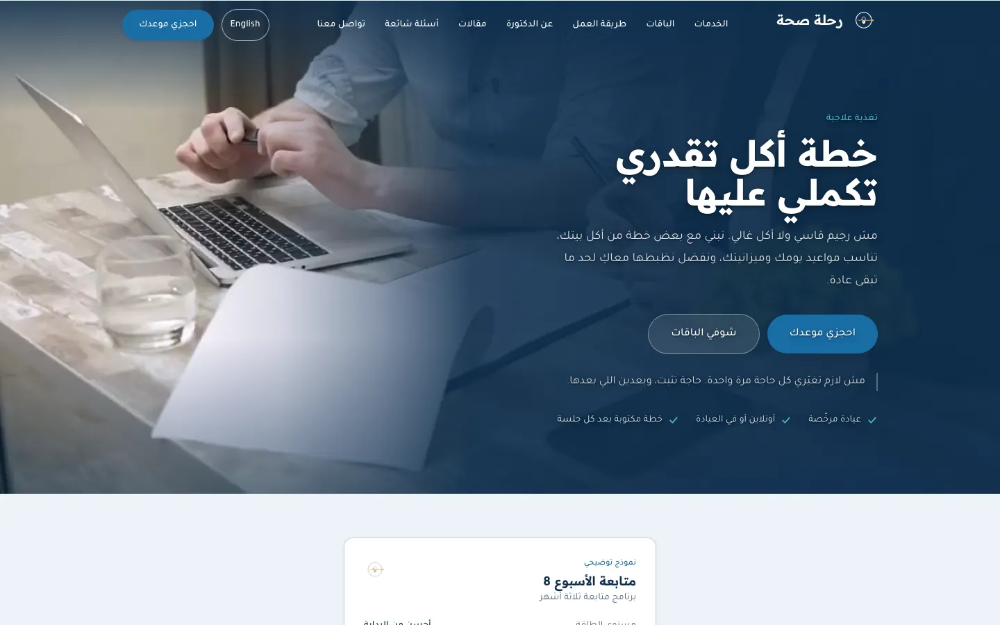

</div>

---

## 🌿 Overview

**Rehlet Sehha** ("a health journey") serves one clinical nutrition practice and its practitioner. Patients read about the services and clinically reviewed articles, book an appointment — online or in the clinic — **without creating an account**, and get a private link to manage that booking. Staff run the day from an Arabic admin panel.

| | |
|---|---|
| 🌐 **Website** | Services, packages, specialties, how it works, about, FAQ and contact — Arabic (right-to-left, default) and English. |
| 📚 **Articles** | Clinically reviewed articles that **cannot be published** without a named reviewer, a review date and verified citations. |
| 📅 **Booking** | A four-step Livewire wizard on top of an availability engine, with double booking prevented **by the database**, not by luck. |
| 🔗 **Patient link** | A private, tokenised page where the patient reschedules, cancels, reviews or erases their intake form and downloads their data. |
| ✉️ **Notifications** | Confirmations, reminders 24 h and 1 h before, review invitations and a 07:00 daily schedule for the clinic — every send logged. |
| 🛠️ **Staff panel** | Filament admin for appointments, patients, schedule, content and clinic settings — with roles, MFA and a clinical-read audit trail. |

> [!NOTE]
> It is a **single-clinic** application — not a multi-tenant platform — and it has **no payment processing**. It stores health information, so privacy decisions run through the whole codebase (see [Security and privacy](#-security-and-privacy)).

---

## 📸 Screenshots

<sub>Captured from a local copy with seeded demo patients; phone numbers are masked.</sub>

### Public website

| Home · English | Services · Arabic |
|---|---|
| 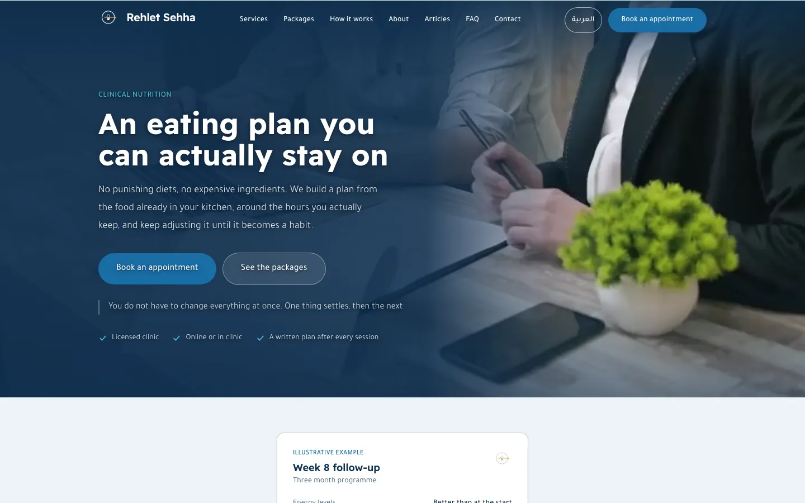 | 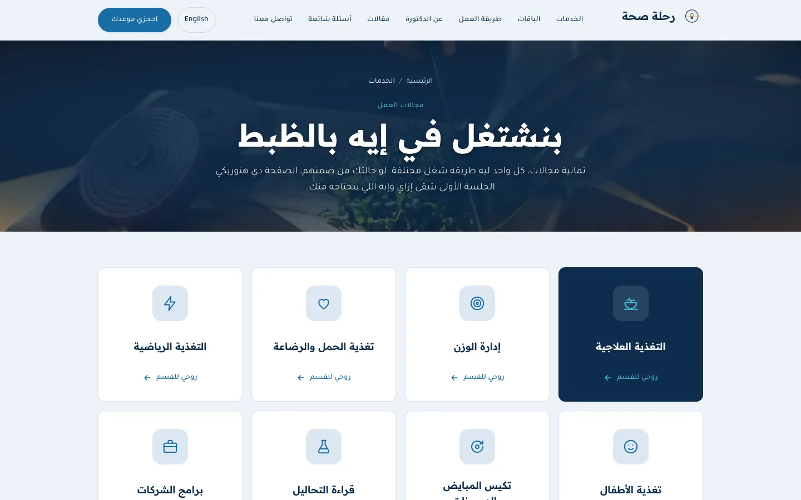 |
| **Articles — each one clinically reviewed** | **Patient's private booking link** |
| 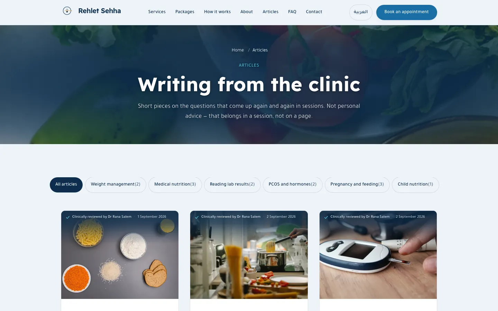 | 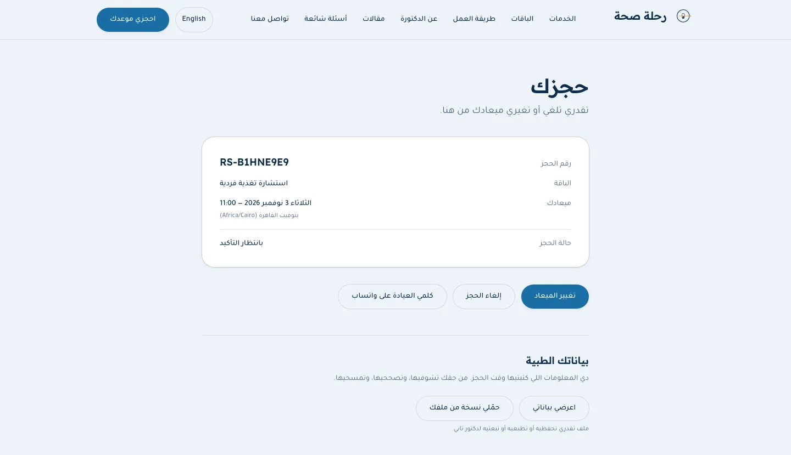 |

### Booking wizard

| Step 1 · Choose the package | Step 2 · Choose the day and time |
|---|---|
| 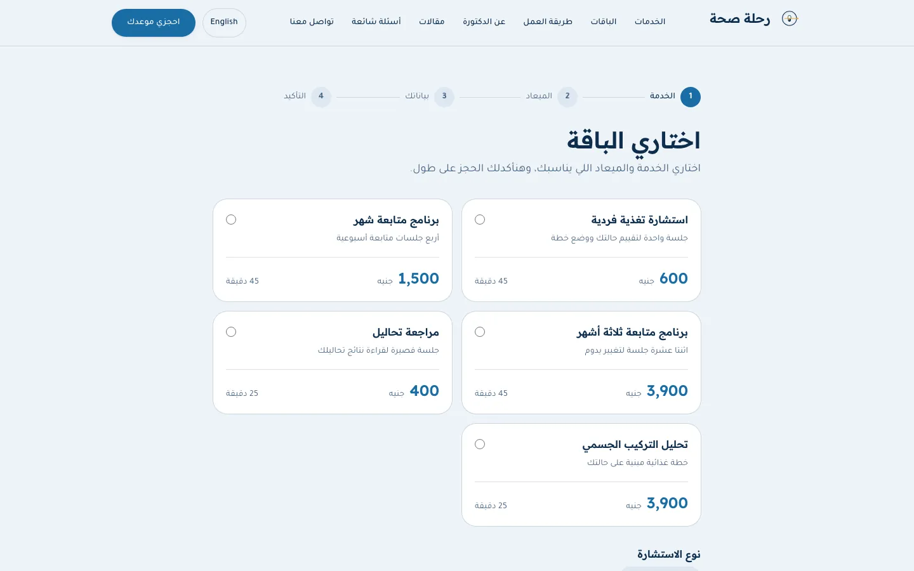 | 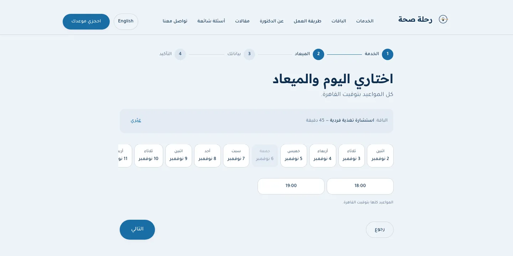 |

### Mobile first

<p align="center">
  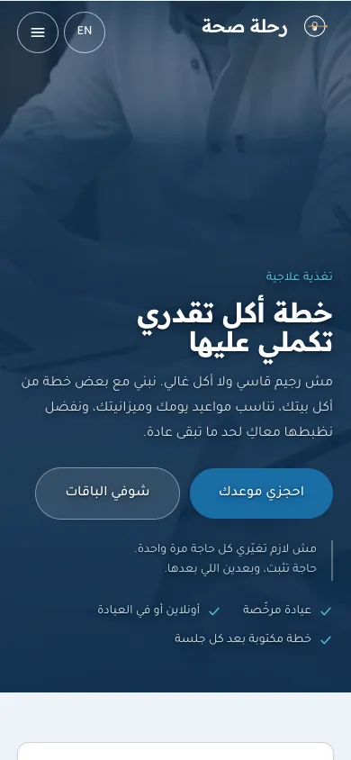
  &nbsp;
  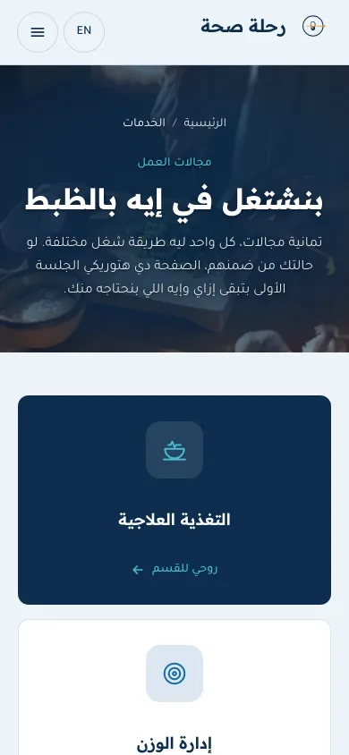
  &nbsp;
  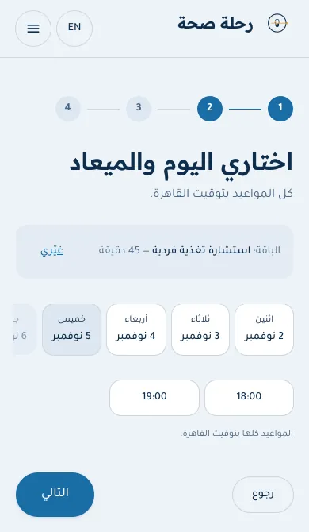
</p>

### Staff panel (`/admin`)

| Dashboard — awaiting confirmation, today, this week | Appointments |
|---|---|
| 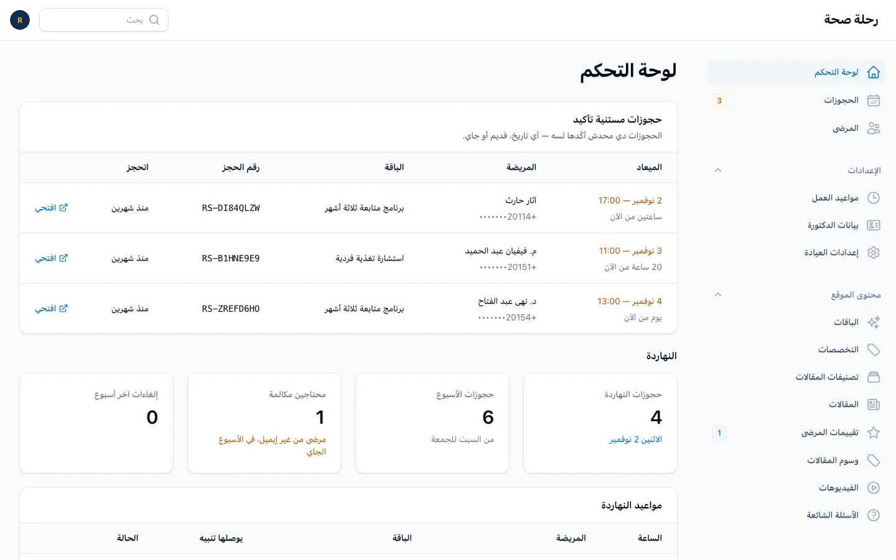 | 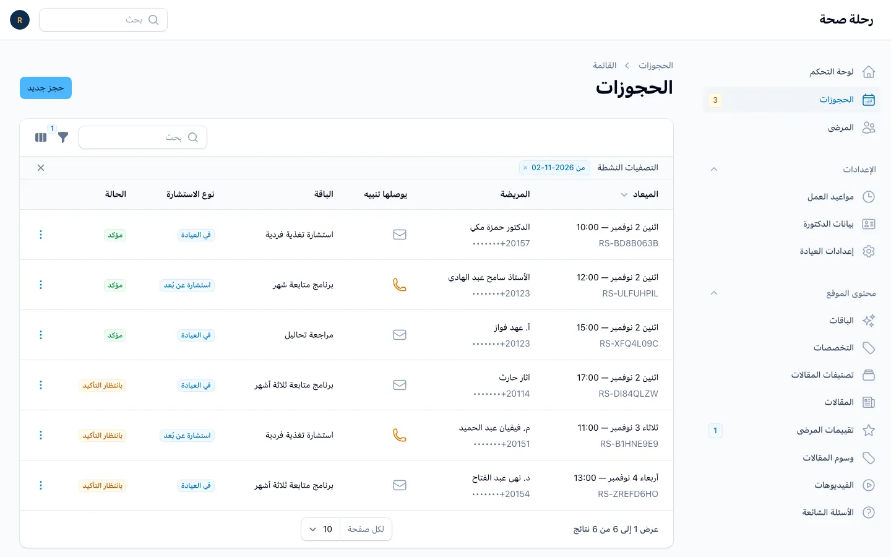 |
| **One appointment — confirm, reschedule, complete, no-show, cancel** | **Articles with publish status and languages** |
| 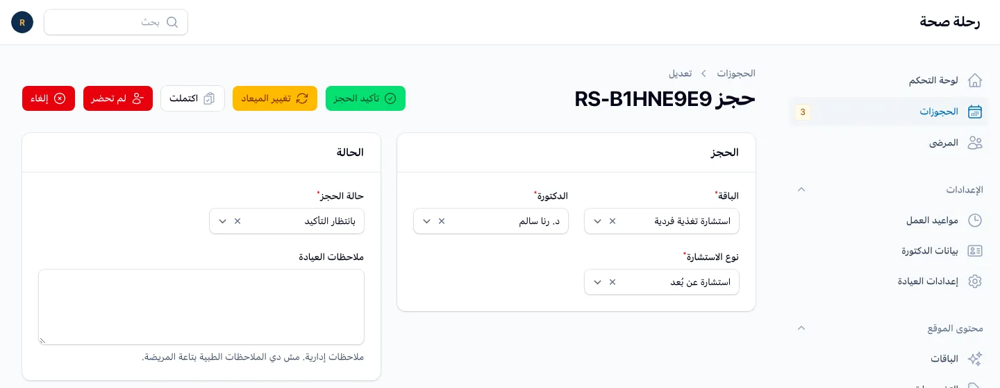 | 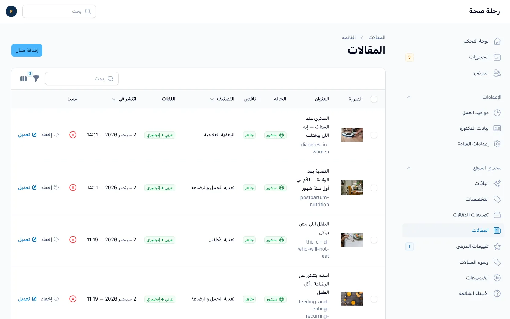 |
| **Clinic settings — contact details and booking rules, no deploy needed** | |
| 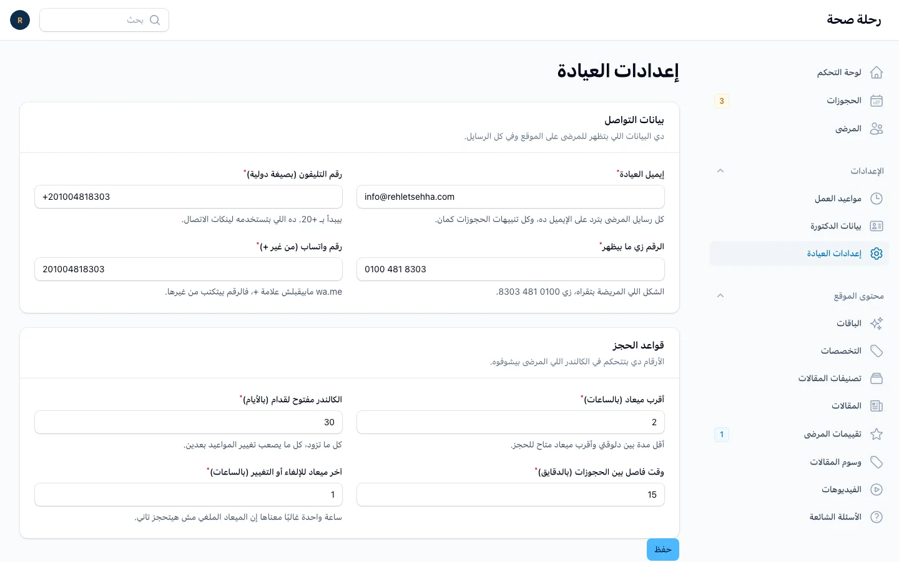 | |

---

## ✨ Features

<details open>
<summary><b>🌐 Public website</b></summary>

- Arabic (default, RTL) and English versions of every public page: home, services, packages, how it works, about, FAQ, contact, privacy notice, specialties and articles (by category and by tag).
- **Publishing gated in the model:** a post cannot be saved as published without a named clinical reviewer and review date, while it still contains open `CLINICAL_INPUT` / `PRACTITIONER_VOICE` markers, or while any of its citations is low-confidence or unverified.
- Homepage **plate builder** with portions and an energy estimate, featured videos (YouTube behind a click-to-play facade on `youtube-nocookie.com`) and patient reviews.
- Hero video with copy synced to the cuts in the clip; full-bleed page headers; self-hosted fonts (Readex Pro, Tajawal).

</details>

<details open>
<summary><b>📅 Booking (Livewire)</b></summary>

- Step-by-step wizard: **service → day → time slot → patient details and intake questionnaire** (goal, medical history, medications).
- Availability calculated from working hours, existing appointments, blocked slots, booking lead time, booking horizon and the buffer between appointments.
- **Double booking is impossible at the database level** — see [booking-concurrency.md](docs/architecture/booking-concurrency.md).
- Patients without an email address can still book: they are told beforehand that no email will arrive, and the confirmation screen becomes their record.

</details>

<details open>
<summary><b>🔗 The patient's private link</b></summary>

- Every appointment has a tokenised management link: **cancel, reschedule, view and edit the intake form, erase it**, and download a self-contained HTML copy of their data.
- Review invitations three days after a completed appointment, through a tokenised link; patients can withdraw a review they submitted.
- Token URLs are `noindex`, rate-limited and served with their own restrictive headers.

</details>

<details open>
<summary><b>✉️ Notifications</b></summary>

- **Patient emails:** booking confirmed, rescheduled, cancelled, reminders 24 hours and 1 hour before, review request.
- **Clinic emails:** new booking, cancellation, failed patient email, and a **07:00 daily schedule** (Cairo time) that includes a call list for patients without email.
- Each notification is recorded in a delivery log as **sent, queued or deliberately skipped** (for example, a patient with no email address).

</details>

<details open>
<summary><b>🛠️ Staff panel (Filament, <code>/admin</code>)</b></summary>

- Dashboard: appointments awaiting confirmation, today's schedule and a clinic overview (today, this week, patients to call, cancellations).
- Appointments: confirm, complete, mark no-show, cancel, reschedule; intake forms visible to clinical roles only.
- Patients, services, specialties, working hours, FAQ, articles, categories, tags, videos, reviews (moderation) and staff users.
- **Clinic settings** (contact details, booking rules) and the **practitioner profile** (name, titles, licence, training) — editable without a deploy.

</details>

<details open>
<summary><b>🔎 SEO</b></summary>

- Per-locale URLs, `sitemap.xml`, JSON-LD structured data (`MedicalClinic`, breadcrumbs, articles with their reviewer), Open Graph images and a web app manifest.

</details>

<details open>
<summary><b>⚙️ Operations</b></summary>

- `/up` health endpoint reporting **database, storage, cache, scheduler, queue, backups and deployment** state.
- Encrypted daily database backups (`spatie/laravel-backup`), and an `APP_KEY` fingerprint check that detects a changed key before encrypted records become unreadable.
- A scheduled **deployment watcher** that finishes every release on its own (see [Deployment](#-deployment)).
- Scheduled retention pruning for the delivery log and activity log.

</details>

---

## 🗓️ How a booking works

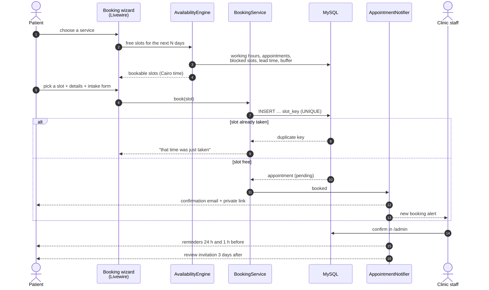

---

## 🧭 Architecture

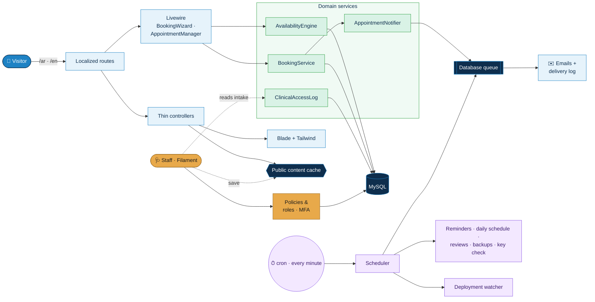

- **Thin controllers** — one per public page; the interactive parts are two Livewire components: `BookingWizard` and `AppointmentManager` (the patient's private link).
- **Domain services** hold the rules: `AvailabilityEngine` decides what is bookable, `BookingService` creates and moves appointments safely, `AppointmentNotifier` decides who is told what and when, `ClinicalAccessLog` audits every read of a clinical record.
- **Status and type values are Enums** (`AppointmentStatus`, `AppointmentMode`, `DeliveryOutcome`, `CitationConfidence`, …); authorisation lives in a **Policy** for every admin resource.
- **No long-running worker.** Background work runs on the `database` queue, which the scheduler drains every minute — the application needs only cron.
- **Times are stored in UTC** and shown in the clinic's time zone (`CLINIC_TIMEZONE`, Cairo).

### Project structure

```
app/
  Http/Controllers/       one controller per public page, plus health, sitemap, export
  Http/Middleware/        locale, security headers, HTTPS, token-URL headers, admin session expiry
  Livewire/               BookingWizard, AppointmentManager (the patient's private link)
  Services/
    Availability/         AvailabilityEngine — which slots are bookable
    Booking/              BookingService — creating and moving appointments safely
    Clinical/             ClinicalAccessLog — audit of reads of clinical records
    Notifications/        AppointmentNotifier — who is told what, and when
  Notifications/          one class per email
  Enums/                  appointment status/mode, delivery outcome, citation confidence, …
  Filament/               resources, pages, widgets and actions for /admin
  Policies/               authorisation for every admin resource
  Support/                structured data, settings, public content cache, locales, deployment state
  Console/Commands/       clinic:* scheduled jobs and maintenance tools
routes/web.php            public routes, all under /{locale}
routes/console.php        the schedule
lang/{ar,en}/             translations (22 files per language)
database/seeders/         roles, staff, schedule, services and published content
docs/                     architecture, deployment, brand, media and content notes
```

### Tech stack

| Layer | Technology |
|---|---|
| Language / framework | PHP 8.4+, Laravel 12 |
| Admin panel | Filament 5 |
| Interactive components | Livewire 4 |
| Database | MySQL 8 |
| Front-end | Tailwind CSS 4, Vite 7, self-hosted fonts (Readex Pro, Tajawal) |
| Roles and permissions | spatie/laravel-permission |
| Translatable content | spatie/laravel-translatable |
| Audit trail | spatie/laravel-activitylog |
| Backups | spatie/laravel-backup |
| Tests / quality | Pest 3, PHPUnit 11, Larastan (PHPStan level 6), Laravel Pint |

Exact versions are pinned in `composer.lock` and `package-lock.json`.

---

## 📊 Quality in numbers

| Check | Result |
|---|---|
| Automated tests | **938** passing, serial run (feature, Livewire, policy, booking-race, notification, security-header and build tests) |
| Static analysis | Larastan **level 6**, no errors |
| Code style | Laravel Pint, passing |
| Dependencies | `composer audit` — **0** advisories |
| Front-end build | `public/build` is committed and a test fails if it is stale |
| Translations | Copy still awaiting the practitioner's wording is marked `TODO_COPY`; `clinic:verify-copy` fails while any remains |

---

## 🔐 Security and privacy

This application stores health information.

- **Encrypted** model attributes for clinical data; an `APP_KEY` fingerprint check (`clinic:verify-key`, daily) catches a changed key early.
- **Role-based access** with a policy on every admin resource; **MFA** for administrators; a clinical-read audit trail; idle staff sessions end after 30 minutes.
- **Content-Security-Policy** with per-request nonces, HSTS, `X-Frame-Options: DENY`, `nosniff`, a restrictive Permissions-Policy, HTTPS redirect, and `noindex` for the panel and tokenised patient URLs.
- **No analytics, tag managers or third-party scripts** on public pages; fonts are self-hosted.
- Patients can **export** their data and **erase** their intake form from their private link — access rights under Egypt's Personal Data Protection Law (Law 151 of 2020).
- **Encrypted backups** when `BACKUP_ARCHIVE_PASSWORD` is set; retention windows for logs.

### Roles

| Role | Access |
|---|---|
| `admin` | Everything, including staff users and settings. **Multi-factor authentication (authenticator app) is required.** |
| `doctor` | Everything except staff users and some deletions: appointments, patients, clinical intake forms, the schedule, content, clinic settings and the practitioner profile |
| `receptionist` | Appointments and patients, **without** clinical intake data |

Every read of a clinical intake form, and every refused attempt, is recorded in the activity log.

Before changing anything about secrets, keys or the server, read [launch-security-checklist.md](docs/deployment/launch-security-checklist.md). Please report security problems **privately** to the repository owner rather than in a public issue.

---

## 🚀 Getting started

### Requirements

- PHP **8.4.1 or later**, with `gd` (WebP support), `intl`, `mbstring`, `pdo_mysql`, `openssl`, `curl`, `fileinfo`, `zip`, `bcmath`, `exif`. (`composer.json` still says `^8.2`, but the locked dependencies need 8.4.1.)
- Composer 2 · MySQL 8 · Node.js 20.19+ or 22.12+ and npm (for Vite 7)

### Local installation

```bash
git clone https://github.com/m77mdabdo/rehlet_sehha.git
cd rehlet_sehha

composer install
npm install

cp .env.example .env
php artisan key:generate
```

> [!IMPORTANT]
> `.env.example` is the **production** template on purpose (`EnvironmentExampleTest` keeps it that way). Edit `.env` for local use **before** migrating — see the table below.

Then create the database and run:

```bash
php artisan migrate --seed
npm run build
composer dev        # serve, queue listener, log tail and Vite, together
```

The site is at `http://127.0.0.1:8000/ar` and the panel at `/admin`.

(`composer setup` exists too, but it migrates immediately after copying `.env.example`, before you have pointed `.env` at a local database.)

### Environment configuration

Values to change in `.env` for local development:

| Key | Local value |
|---|---|
| `APP_ENV` | `local` |
| `APP_DEBUG` | `true` |
| `APP_URL` | `http://127.0.0.1:8000` |
| `DB_HOST`, `DB_PORT`, `DB_DATABASE`, `DB_USERNAME`, `DB_PASSWORD` | your local MySQL |
| `MAIL_MAILER` | `log` (emails are written to `storage/logs` instead of sent) |
| `SESSION_SECURE_COOKIE` | `false` when not serving over HTTPS |

Other keys worth knowing (see `.env.example` for the full list):

| Key | Purpose |
|---|---|
| `ADMIN_EMAIL`, `ADMIN_PASSWORD`, `DOCTOR_EMAIL`, `DOCTOR_PASSWORD` | Staff accounts created by the seeders. If a password is not set, a random one is generated and printed **once**. |
| `CLINIC_TIMEZONE` | The clinic's local time zone (appointments are stored in UTC) |
| `CLINIC_CONTACT_EMAIL` | Where clinic alerts and the daily schedule are sent |
| `BACKUP_ARCHIVE_PASSWORD` | Encrypts backup archives. **If unset, backups are not encrypted.** |
| `BACKUP_ALERT_EMAIL` | Backup failure alerts |
| `PEXELS_API_KEY` | Only for the stock-media tools (`clinic:fetch-pexels`); not needed to run the site |

Never commit `.env`. Production's `APP_KEY` must never be regenerated; see [APP_KEY.md](docs/deployment/APP_KEY.md).

### Database

```bash
php artisan migrate            # schema
php artisan db:seed            # roles, staff, schedule, services, content
```

`DatabaseSeeder` runs every seeder in dependency order (a test fails if a new seeder is not wired in). `DemoAppointmentSeeder` creates fake patients and appointments **only when `APP_ENV=local`** and does nothing elsewhere.

> [!CAUTION]
> Never run `migrate:fresh` against production.

### Front-end

```bash
npm run dev       # Vite dev server with hot reload
npm run build     # production build into public/build
```

**`public/build` is committed**, because the host does not run a Node build. After any change to `resources/css` or `resources/js`, run `npm run build` and commit the new hashed files together with the deletion of the old ones; `BuiltAssetsAreCommittedTest` fails otherwise.

### Tests and code quality

```bash
php artisan test               # full suite, serially
./vendor/bin/pint --test       # code style
./vendor/bin/phpstan analyse   # static analysis
composer audit                 # known vulnerabilities in PHP dependencies
```

- Tests use the `rehlet_sehha_test` database. `phpunit.xml` overrides only `DB_DATABASE`, so the host, port and credentials come from `.env`.
- Some tests read the base test database directly; migrate it once in a new environment with `DB_DATABASE=rehlet_sehha_test php artisan migrate`. (Do not use `--env=testing` for this: without a `.env.testing` file it falls back to `.env` and migrates the development database.)
- `php artisan test --parallel` is faster but currently shows occasional failures that do not reproduce serially; treat the serial run as authoritative.

### Localization

- Supported locales: `ar` (default, RTL) and `en`, configured in `config/app.php` (`supported_locales`).
- Every public URL is prefixed with the locale (`/ar/...`, `/en/...`); `/` redirects to the default. The staff panel is in Arabic regardless of the public site's language.
- Interface strings live in `lang/ar` and `lang/en`; database content (services, articles, FAQ, specialties) is stored per locale with spatie/laravel-translatable.
- Run `php artisan clinic:verify-copy` before a release (the automatic deployment does not run it for you).

---

## ⏱️ Scheduled jobs

One cron entry — `* * * * * php artisan schedule:run` — runs everything (times in clinic time):

| Job | When | What it does |
|---|---|---|
| `queue:work --stop-when-empty` | every minute | Drains the database queue (emails) |
| `clinic:send-reminders` | every minute | Reminders 24 h and 1 h before each appointment |
| `clinic:watch-deployment` | every minute | Finishes a release after a push (see below) |
| heartbeat | every 5 minutes | Lets `/up` prove the scheduler is alive |
| `backup:clean` · `backup:run --only-db` | 02:00 · 02:30 | Encrypted database backups and retention |
| `clinic:verify-key` | 03:00 | `APP_KEY` still matches the key that encrypted clinical data |
| `model:prune` | 03:30 | Delivery-log and activity-log retention |
| `clinic:send-daily-schedule` | 07:00 | The day's appointments to the clinic, with a call list |
| `clinic:send-review-requests` | 10:00 | Review invitations, three days after a completed visit |

---

## 🚢 Deployment

Production runs on shared hosting with Git deployment from `main`.

> [!WARNING]
> **A push to `main` is a production deployment.** There is no staging step in between.

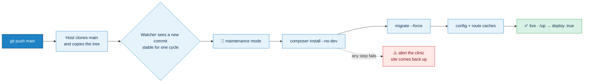

1. The host clones `main` and copies it into the web root (it runs no build step of its own).
2. The scheduled `clinic:watch-deployment` command notices the new commit and finishes the release behind maintenance mode. A lock prevents two rebuilds at once, a failed commit is not retried every minute, and the site is always brought back up. A push is normally fully live **within two minutes**.
3. `/up` reports `deploy: true` once the deployed commit has been built.

The only server-side requirement besides PHP and MySQL is the cron entry. The step-by-step guide, including the manual fallback sequence, is [hostinger.md](docs/deployment/hostinger.md).

### Maintenance and troubleshooting

| Symptom | Where to look |
|---|---|
| `/up` reports `scheduler: false` | Cron is not running `schedule:run`; see [cron.md](docs/deployment/cron.md) |
| `/up` reports `deploy: false` for more than a few minutes | The watcher failed or stopped; `storage/logs/laravel.log`, then run `php artisan clinic:watch-deployment --force` |
| Admin panel has no styling after a deploy | `composer install` did not run, so Filament's assets were not published |
| Every test fails with `Access denied` or `Connection refused` | `.env` database settings, or MySQL is not running |
| Emails not arriving | The delivery log in the panel, then [mail-authentication.md](docs/deployment/mail-authentication.md) |
| Opening a backup archive | `php artisan clinic:unpack-backup` (standard `unzip` cannot open AES-encrypted archives) |

```bash
php artisan clinic:verify-key                  # APP_KEY matches the stored fingerprint
php artisan clinic:send-review-requests --dry-run
php artisan clinic:verify-copy                 # TODO_COPY left in translations
php artisan schedule:list                      # everything the scheduler runs
```

---

## 🗺️ Roadmap

### ✅ Delivered

- [x] Bilingual public website, Arabic-first with full RTL, SEO and structured data
- [x] Clinically reviewed articles with a publishing gate (reviewer, review date, verified citations)
- [x] Four-step booking wizard with an availability engine and database-level double-booking protection
- [x] Booking without an account — including patients with no email address
- [x] Patient's private link: reschedule, cancel, intake form view/edit/erase, data export
- [x] Email notifications with a delivery log; 24 h / 1 h reminders; 07:00 daily schedule; review invitations
- [x] Filament staff panel with three roles, MFA for admins, clinical-read audit trail and idle-session expiry
- [x] Clinic settings and practitioner profile editable without a deploy
- [x] Plate builder with portions and an energy estimate; hero video; video facade
- [x] Strict CSP with nonces, security headers, encrypted clinical fields and encrypted backups
- [x] `/up` health endpoint and the scheduled deployment watcher
- [x] Dependency audit cleared (10 advisories → 0) and a serial test suite fully green

### 🟡 Implemented only in part

Stated plainly so nobody builds on an assumption:

- **WhatsApp and SMS** exist as values in `NotificationChannel`, but nothing sends through them. Email is the only automated channel; WhatsApp appears as a contact link and a "send it to yourself" action.
- **Booking source** has `phone` and `walk_in` values, but only `website` is ever assigned; appointments created in the panel are recorded as `website`.
- **Testimonials, plate-builder foods and blocked slots** are read by the site but have no admin screen; they are maintained through seeders or the database.

### 🔜 Next

- [ ] Run `clinic:verify-key` at the start of every automatic deploy, and abort on a mismatch
- [ ] Booking source field on the staff form, so phone and walk-in bookings are recorded as such
- [ ] Admin screens for testimonials, plate-builder foods and blocked slots
- [ ] WhatsApp reminders as a second channel
- [ ] Continuous integration on GitHub Actions (tests, Pint, Larastan, build check)
- [ ] Key-based SSH on the server; `npm audit fix` for two dev-only advisories
- [ ] Raise the PHP constraint in `composer.json` to `^8.4`
- [ ] Find the cause of the parallel-only test flakes
- [ ] Laravel 13 upgrade before Laravel 12 security support ends (February 2027)

---

## 📚 Documentation

| Path | Contents |
|---|---|
| [docs/deployment/](docs/deployment/) | Hosting and deployment, cron, mail authentication, `APP_KEY`, launch security checklist |
| [docs/architecture/booking-concurrency.md](docs/architecture/booking-concurrency.md) | How double booking is prevented |
| [docs/brand.md](docs/brand.md), [docs/media/photography.md](docs/media/photography.md) | Brand assets and the photography policy, including licensing |
| [docs/content/](docs/content/) | Editorial working documents for articles (generated by `clinic:export-review-docs`) |

---

<div dir="rtl">

## 🇪🇬 نبذة بالعربية

**رحلة صحة** موقع وعيادة تغذية علاجية إلكترونية باللغتين العربية والإنجليزية، شغّالة فعليًا على [rehletsehha.com](https://rehletsehha.com):

- **الموقع:** صفحات الخدمات والباقات والتخصصات وطريقة العمل وعن الدكتورة والأسئلة الشائعة، بالعربي (من اليمين للشمال) والإنجليزي.
- **المقالات:** مقالات علمية مُراجَعة — المقال ما ينفعش يتنشر من غير اسم المراجِع وتاريخ المراجعة ومصادر متأكَّد منها.
- **الحجز:** حجز أونلاين أو في العيادة على أربع خطوات من غير ما المريضة تعمل حساب، والنظام يمنع الحجز المزدوج من قاعدة البيانات نفسها.
- **رابط خاص لكل مريضة:** تغيّر الميعاد أو تلغيه، تشوف بياناتها الطبية أو تعدّلها أو تمسحها، وتحمّل نسخة منها.
- **الإشعارات:** تأكيد الحجز، تذكير قبل الميعاد بـ ٢٤ ساعة وبساعة، دعوة للتقييم، وجدول يومي للعيادة الساعة ٧ الصبح.
- **لوحة التحكم:** لوحة عربية للطاقم (أدمن، دكتورة، استقبال) لإدارة المواعيد والمرضى والمحتوى وإعدادات العيادة، مع تحقق ثنائي للأدمن وسجل لكل قراءة لبيانات طبية.
- **النشر:** أي `push` على `main` بيتنشر على السيرفر مباشرة، وأمر مجدول بيكمّل خطوات النشر لوحده في خلال دقيقتين تقريبًا.

</div>

---

## 📄 Ownership and licensing

Designed, built and maintained by **Mohamed Abdo** ([@m77mdabdo](https://github.com/m77mdabdo)).

**No open-source licence has been granted.** The repository is publicly visible, but no licence file is included, so all rights are reserved by the owner. Third-party packages remain under their own licences. Stock photography is used under the Pexels licence, with sources recorded as described in [photography.md](docs/media/photography.md).
